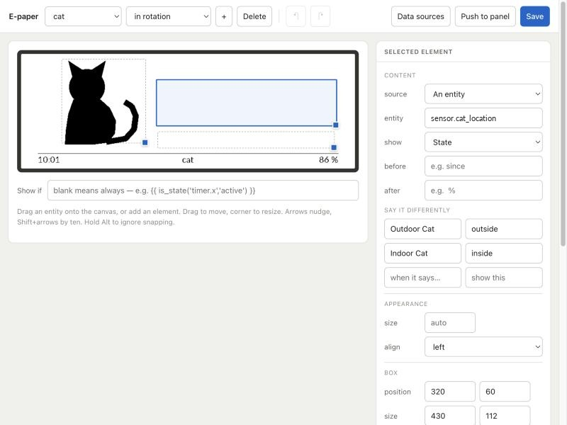

> Vibecoded! While I strive to keep things safe and limit vulnerabilities, you should be aware and use at your own risk.

# E-paper panel

A Home Assistant add-on that renders your entities and live feeds onto an Elecrow CrowPanel e-paper display, with a drag-and-drop visual studio for designing every screen down to the pixel.


Designed around one constraint: the panel hangs about three metres from a sofa. At that distance a 25 px character is at the threshold of legibility and 110 px is effortless — on a 272 px-tall panel that means **bold, high-contrast typography and purposeful hierarchy**, rotating smoothly across screens, rather than a cramped grey dashboard you have to walk up to.

---

## E-Paper Studio (The Visual Editor)



Lives in your Home Assistant sidebar behind your existing login. Designed to blend effortless one-click templates for quick setup with hyper-customizable pixel control for power users:

- **Built-In & Custom Screen Presets:** Click **Presets** to add battle-tested screen templates (`Room Climate & Comfort`, `Solar Power & Generation`, `Weather & 4-Day Forecast`, `Energy & Battery Gauges`, `Guest Wi-Fi QR Card`, `Airspace Radar (ADS-B)`, `F1 & Formula E Pit-Wall`, `Sports Scoreboard`, `Calendar Month & Agenda`, `Event Countdown`, `Door & Pet Presence`, `Bin Day Collection`, `Digital Clock & Date`). You can also click **💾 Save Page as Preset…** on any page you design to save it to your personal **Custom Presets** library.
- **Editable Composite Widgets + "✂️ Break Apart":** High-density composite widgets (`weather_forecast`, `flight_tracker`, `sports_racing`, `sports_match`, `calendar_month`, `calendar_agenda`, `dynamic_grid`) include a **Font Scale (`70%`–`160%`)** slider, **Show Outer Border** toggle, and layout-specific density controls (`Forecast Days`, `Split Hero + Forecast` vs `Full-Width Forecast`, `Max Events`, `Max Matches`, `Radar Split` vs `Telemetry Only`). Want total control over every label and number? Click **✂️ Break Apart into Editable Elements** in the inspector to decompose any composite card into individual, draggable `text`, `number`, `icon`, and `line` elements on the canvas.
- **Rich 1-Bit Element Primitives:**
  - **Big Number (`number`) & Text (`text`):** Crisp typography (**Lato**, **DejaVu Sans**, **Roboto Mono** in Bold or Regular) with optional **Invert (White on Black)** and **Pill / Badge Frame** styling + configurable corner radius.
  - **MDI Vector Icons (`icon`):** Any `mdi:*` icon rendered at crisp 1-bit thresholds, with optional inverted or outlined badge frames.
  - **Box / Card (`box`):** Structural containers, pills, dividers, and **50% Checkerboard Screen (`screen`)** regions with configurable corner `radius` and border `thickness`.
  - **Progress & Gauge Bar (`bar`):** Horizontal (`solid` or `segmented` battery blocks) or `vertical` tank/column gauges bound to any numeric entity, with `min_val`, `max_val`, `title`, `suffix`, and value readout.
  - **Sparkline (`curve`) & Multi-Bar History Chart (`bar_chart`):** Bind directly to Home Assistant entity history (`1`–`72` hours) to render smooth sparklines or bucketed vertical column charts (`4`–`24` bars) with min/max scale labels.
  - **1-Bit QR Code (`qr`):** Zero-dependency ISO 18004 QR generator supporting URLs/text, dynamic entity values, or **Guest Wi-Fi credentials** (`SSID`, `Password`, `WPA/WPA2`/`WEP`/`Open`) so guests can scan the wall panel to join your network.
- **Multi-Select (`Shift+Click`), Group Alignment & Smart Snap Guides:**
  - Dragging any element on the canvas displays live **magenta smart snap guides** when aligning with the canvas centerlines or other elements' edges and centers (hold `Alt` to bypass snapping).
  - Hold **`Shift` + Click** to select multiple elements on the canvas, move or arrow-nudge them together, or use the **Multi-Element Alignment Toolbar** (`Align Left`, `Center H`, `Align Right`, `Align Top`, `Middle V`, `Align Bottom`, `Distribute H`, `Distribute V`, `Duplicate Selected`, `Delete Selected`).
- **Plain-English Bindings & Per-Element Conditional Visibility (`show_if`):**
  - Bind elements to an entity's state, an attribute, `last_changed`, a date countdown (`days_until`), formatted dates (`date_formatted`), or next calendar title (`calendar_title`) without writing Jinja. A visual "say it differently" table maps raw states (`on` → `Open`) automatically, while raw Jinja templates remain available at any time.
  - Every individual element also has its own **Element Visibility (`show_if`)** rule so individual warning badges, icons, or secondary metrics can appear or hide dynamically on the same page.
- **Flexible Viewing Distance Legibility:** Real-time font size and millimetre calculation in the inspector with selectable viewing distances: **Desk (0.8 m)**, **Bedside (1.5 m)**, **Sofa (3.0 m)**, **Wall (5.0 m)**, or **Disabled**.
- **Zero-Reflash Hardware Refresh Rate Slider:** Adjust how frequently the hardware panel fetches and redraws directly from the editor toolbar (1–60 minutes).

---

## Pages Appear When They Matter

Each page has a display tier:

| Tier | Behaviour |
|---|---|
| **In rotation (`rotation`)** | Takes its turn in the normal rotation sequence |
| **Only when true (`when`)** | Joins the rotation only while its `show_if` condition holds |
| **Interrupt (`alert`)** | Never rotates normally; seizes the screen immediately when its condition becomes true, holds for `hold_minutes`, then hands the panel back |

So a dryer page exists only while the dryer is running, a Premier League scoreboard joins the rotation automatically 2 hours before kickoff, and an "arriving home" or "water leak" alert can take over the panel immediately and then vanish.

---

## Night / Quiet Hours (Zero-Ghosting Deep Idle)

E-paper retains its image indefinitely with zero power draw and zero backlight, so turning the screen black at night defeats the purpose of e-ink. However, refreshing and rotating pages every few minutes while everyone is asleep or away causes unnecessary e-ink mechanical wear and visible black-white flashing in dark rooms.

Click **`🌙 Quiet`** in the top toolbar (or **Settings → Night / Quiet Hours…**) to configure **Night / Quiet Hours** (`Off` by default):

- **On / Off Toggle (`enabled`):** Enable or disable Quiet Hours at any time with one click.
- **Daily Quiet Window (`start` – `end`):** Set your overnight quiet schedule in `HH:MM` (e.g. `23:30` to `07:00`). Supports both overnight spans (`23:30`–`07:00`) and daytime spans (`09:00`–`17:00`).
- **Optional Away / Presence Entity (`presence_entity`):** Optionally bind a Home Assistant entity such as `zone.home`, `person.*`, `group.family`, or `input_boolean.sleep_mode`. When its state is `0`, `not_home`, `away`, or `off`, Quiet Hours activate automatically even outside the scheduled clock window.
- **Sleep screen (`sleep_screen`, on by default):** While quiet hours last, the panel sleeps: large closed eyes and when it wakes ("back at 07:00", or "back when someone’s home" when nobody's home), so you can tell from across the room. Any press wakes it, and after two untouched minutes it goes back to sleep. Morning wakes it. A locked page stays on screen instead, and turning the switch off keeps your pages up all night.
- **Sleep any time:** hold the dial centre for a second, or use the panel's **Sleep** switch in Home Assistant (handy in automations). It sleeps until something wakes it: "press any button to wake".
- **Allow Interrupt Alerts (`allow_alerts`):** When enabled (default), high-priority **Interrupt (`alert`)** pages will still wake and push to the panel during Quiet Hours.
- **How It Works Under the Hood:**
  1. When Quiet Hours begin, the server pushes one last update whose frame file is marked quiet, then stops pushing until Quiet Hours end. The wake-up at the end is retried until the panel confirms it.
  2. The ESP32 pauses its 10-second auto-rotation timer so the display performs **zero physical refreshes** while holding the current page cleanly on screen.
  3. Because the ESP32 stays connected to Wi-Fi in light-sleep, **physical buttons and IKEA BILRESA scroll remotes remain 100% responsive** if you manually flip pages at night.
  4. Publishes `sensor.epaper_quiet_hours` (`active` / `inactive`) to Home Assistant with schedule and trigger reason attributes.

---

## Built-In Live Integrations & Composite Cards

In addition to rendering any Home Assistant entity, the add-on includes built-in data engines that require zero external API keys. All add-on-generated entities use the **`sensor.epaper_*`** namespace (tagged with an **`E-PAPER`** badge and filterable via the **`✦ E-Paper`** chip in the Studio's Entities Explorer) and are published **on-demand** only for widgets present in your layouts:

- **Weather & Multi-Day Forecast (`weather_forecast`):**
  - Displays current conditions alongside a 3-to-5 day forecast (`Split Hero + Forecast` or `Full-Width Forecast Only`).
  - Uses a **4-tier forecast resolver**: (1) HA REST `weather.get_forecasts` (`daily` / `hourly`), (2) HA WebSocket `weather/get_forecasts`, (3) legacy `attributes.forecast`, and (4) **automatic Open-Meteo fallback** using your Home Assistant `zone.home` coordinates so forecasts never get stuck on `"Forecast loading..."`.
- **Real-Time ADS-B Airspace Radar (`flight_tracker`):**
  - Live aircraft tracking via Flightradar24 (with OpenSky fallback) around your `zone.home` coordinates or any custom airport preset (`TSR`, `LHR`, `JFK`, `FRA`, or custom `lat`/`lon`).
  - Renders a 1-bit Plan Position Indicator (PPI) radar scope with range rings, heading vectors, callsigns, routes (`BEY → DUS`), aircraft ICAO types (`A320`, `B77W`), altitude, and groundspeed, expanding multiple overhead aircraft into parallel sub-pages.
  - Includes a self-contained **Only show page when aircraft overhead (> 0)** toggle in the Studio inspector and publishes `sensor.epaper_flights_overhead` and `sensor.epaper_closest_aircraft` on demand.
- **Motorsport Pit-Wall (`sports_racing` — Formula 1, Formula E, NASCAR & IndyCar):**
  - Live calendar, circuit telemetry, practice/qualifying/sprint/race session countdowns (automatically converted to your local timezone), and live standings/results for **Formula 1 (`f1`)**, **Formula E (`fe`)**, **NASCAR (`nascar`)**, and **IndyCar (`indycar`)**.
  - Includes self-contained **Active Race Window** controls directly in the Studio inspector: toggle **Only show page during active race window**, choose **Around Each Session (FP / Quali / Race)** or **Entire Race Weekend (FP1 → Checkered Flag)**, and set **`show before (hrs)`** and **`show after (hrs)`** without touching Home Assistant sensor settings. Publishes `sensor.epaper_racing_<series>` (`active` / `idle`) on demand.
- **Live Sports Scoreboard (`sports_match`):**
  - Tracks **Premier League**, **UEFA Champions League**, **La Liga**, **Bundesliga**, **Serie A**, **NBA**, **NFL**, **MLB**, and **NHL** with optional team filtering, localized kickoff times, live scores, and scorer highlights.
  - Includes self-contained **Active Matchday Window** controls directly in the Studio inspector (`Only show page during active matchday window`, `show before (hrs)`, `show after (hrs)`). Switching leagues or filtering by team automatically updates the active window and publishes the matching `sensor.epaper_sports_<league>` (`active` / `idle`) sensor on demand.

---

## Hardware & Supported Models

The add-on is designed for the **Elecrow CrowPanel E-Paper** family (ESP32-S3).

### Compatibility Matrix

| Model | SKU | Resolution | Active Area | Aspect Ratio | Driver Component | Status |
|---|---|---|---|---|---|---|
| **CrowPanel 5.79"** | `DIS08792E` | 792 × 272 px | 139.1 × 47.7 mm | ~2.9:1 (panoramic) | `crowpanel_epaper` (`5.79in`) | **Primary / Fully Tested** |
| **CrowPanel 4.2"** | `DIS08042E` | 400 × 300 px | 84.8 × 63.6 mm | 4:3 | `crowpanel_epaper` (`4.2in`) | Supported |
| **CrowPanel 2.9"** | `DIS08029E` | 296 × 128 px | 66.9 × 29.1 mm | ~2.3:1 (compact) | `waveshare_epaper` (`2.90inv2`) | Supported |
| **CrowPanel 7.5"** | `DIS08075E` | 800 × 480 px | 163.2 × 97.9 mm | 5:3 | `waveshare_epaper` (`7.50inv2`) | Supported |
| **CrowPanel 10.2"** | `DIS08102E` | 960 × 640 px | 215.0 × 143.4 mm | 3:2 (large) | `waveshare_epaper` (`10.2in`) | Supported |

> [!NOTE]
> The **CrowPanel 5.79"** is the primary reference board on which the rendering pipeline and firmware were developed. You can switch models at any time using the **Model** selector in the editor toolbar or inside the **Panel setup** wizard; the editor and firmware generator automatically adjust dimensions, aspect ratios, component platforms, and DPI legibility metrics.

### Firmware & ESPHome Integration

The firmware is ESPHome and the reference configuration lives in [`esphome/crowpanel-epaper.yaml`](esphome/crowpanel-epaper.yaml). The built-in **Panel setup** wizard generates ready-to-paste YAML for your selected model:
- Models **5.79"** and **4.2"** use the [`ESPBoards/esphome-lvgl-crowpanel-epaper-5.79-4.2`](https://github.com/ESPBoards/esphome-lvgl-crowpanel-epaper-5.79-4.2) external component.
- Models **2.9"**, **7.5"**, and **10.2"** use ESPHome's standard `waveshare_epaper` platform.

### Mounting Orientations (`0°`, `90°`, `180°`, `270°`)

Whether you mount the panel normally, **upside-down (`180°`)** to route the USB-C cable cleanly, or **vertically in portrait (`90°` / `270°`)**, the editor toolbar and **Panel setup** wizard let you configure mounting orientation:
- The canvas adapts to your model's logical aspect ratio (e.g. **792×272** landscape or **272×792** portrait on the 5.79") with a one-click **Reflow** helper to restack existing elements.
- The server pre-rotates each page into the panel's native framebuffer and tells the panel where the footer pills ended up, so changing orientation in the editor works on **Save / Push to panel**. Reflashing is only needed for the button swap below.
- When generating new ESPHome firmware for `180°` or `270°` mounts, the wizard also swaps the `Next` and `Prev` button pins (`GPIO 4` and `GPIO 6`) so the physical buttons match the board's orientation.

---

## 2D Hierarchical Navigation & Remote Control

The display organizes content as a two-dimensional grid: **Top-level Categories** along the horizontal axis, and **Parallel Sub-Items** along the vertical axis.

```
Category 1 (Solar)       ──>  Single slide
Category 2 (Watch)       ──>  [Episode 1: Scrubs]  ─>  [Episode 2: Brothers]
Category 3 (Flights)     ──>  [Plane 1: BAW71LK]   ─>  [Plane 2: THY41Y]
Category 4 (Scores)      ──>  [Game 1: Bulls v Bucks] ─> [Game 2: Knicks v Raptors]
```

- **Sequential Sub-Item Rotation Memory (`cat_sub_pos`):** Every category remembers which sub-item it showed last (`cat_sub_pos[c]`). On pass 1 through a multi-item category (e.g. Watch, Airspace Radar, Sports), the panel shows sub-item `1/N`, on pass 2 it shows `2/N`, on pass 3 it shows `3/N`, and so on. Background 1-minute data refreshes preserve `cat_sub_pos` and `sub_idx` so sub-item rotation never resets to page 1.
- **Manual Scroll Protection & 15s Debounce (`user_cool_sec` & `request_refetch`):** Every physical button press and remote scroll action starts a 15-second interaction cooldown (`user_cool_sec`). If a background 1-minute update (`refresh_now`) triggers while you are manually scrolling, the network download is automatically paused (`pending_refetch = true`) so scrolling never freezes, and resumes 15 seconds after you stop scrolling.
- **One checked frame file:** The panel downloads `/frames.epf` in the background, checks it completely (checksum, panel size, every offset), and only then swaps it in. A bad or partial download never reaches the screen, and the buttons never wait for the network.

### Physical Controls & Button Mapping

The CrowPanel features five discrete physical inputs: a 3-way rocker dial (rotate up, rotate down, press center) and two push buttons (top and bottom). The firmware automatically remaps pins to match your mounting orientation:

| Physical Control | Visual Direction | 180° Mount (USB-C Top) | 0° Mount (Standard) | Action & Behavior |
|---|---|---|---|---|
| **Top Button** | Physical Top | `GPIO 1` | `GPIO 2` | **Short Press (<750ms):** Toggle **Category Lock** (`cat_pinned`).<br>**Long Hold (≥750ms):** Toggle **Panel Lock** (`pinned`). |
| **Rocker Turn Forward** | Right / Clockwise | `GPIO 6` | `GPIO 4` | **In Category Mode:** Advance to next category.<br>**In Sub-Item Mode:** Advance to next sub-item within current category. |
| **Rocker Turn Backward** | Left / Counter-Clockwise | `GPIO 4` | `GPIO 6` | **In Category Mode:** Return to previous category.<br>**In Sub-Item Mode:** Return to previous sub-item within current category. |
| **Rocker Center Push** | Push Inward | `GPIO 5` | `GPIO 5` | **Press:** Switch between **categories** and the current category's **items**. A press within 0.4 s of turning the dial is ignored, because the dial tilts as it turns.<br>**Hold (≥1 s):** Put the panel to sleep, or wake it. While it's asleep, any press only wakes it. |
| **Bottom Button** | Physical Bottom | `GPIO 2` | `GPIO 1` | **Short Press (<750ms):** Jump to **Page 1 (Category 1)**.<br>**Long Hold (≥750ms):** Download new frames now and clear ghosting in the same redraw (one flash). |

### ESPHome Native Actions (IKEA BILRESA / Zigbee / Matter Remotes)

The firmware exposes encrypted ESPHome native API actions so external scroll remotes (such as the **IKEA BILRESA** scroll remote) or Home Assistant automations can control the panel seamlessly:

| ESPHome Action | Parameters | Behavior |
|---|---|---|
| `esphome.<device>_page_step` | `delta: 1` or `-1` | Context-aware step: steps categories when in Category mode, or sub-items when in Sub-Item mode. |
| `esphome.<device>_mode_toggle` | *(none)* | Switches between Category Navigation Mode and Sub-Item Navigation Mode (if the current category has multiple sub-pages) and redraws the active focus pill. |
| `esphome.<device>_lock_toggle` | *(none)* | Context-aware lock: toggles **Category Lock** in Category mode, or **Panel Lock** in Sub-Item mode. |
| `esphome.<device>_show_page` | `index: N` | Jumps directly to page `N` (counting from 0) and works out its category automatically. |
| `esphome.<device>_refresh_now` | *(none)* | Downloads new frames from the add-on now (or once scrolling stops). |

---

### Visual Indicators & Status Badges

All navigation states and locks are rendered directly inside the uneditable 32px footer bar, leaving the canvas completely unobstructed:

```
┌────────────────────────────────────────────────────────────────────────┐
│                                                                        │
│                            [ Card Content ]                            │
│                                                                        │
├────────────────────────────────────────────────────────────────────────┤
│ 15:42   [ 1/9 WATCH ] (inverted)   [ 🔒 ]               [ 🔒 ]   [ 1/2 ] │
└────────────────────────────────────────────────────────────────────────┘
```

1. **Active Focus Inversion:**
   - **Category Mode (Default):** The Category Pill (`[ 1/9 WATCH ]`) is solid black with crisp white text. Turning the rocker or remote scroll wheel flips through categories.
   - **Sub-Item Mode:** Toggling mode inverts the Sub-Item Pill (`[ 1/2 ]`) and reverts the category pill to an outline. Turning the rocker or scroll wheel flips through sub-items inside that category.
2. **Padlock Badges:**
   - **Category Lock Badge (`[ 🔒 ]`):** Rendered immediately to the right of the category pill (`[ 1/9 WATCH ] [ 🔒 ]`). Indicates the panel will stay on this category (and cycle its sub-items if any).
   - **Panel Lock Badge (`[ 🔒 ]`):** Rendered beside the sub-item pill (or in the right margin when single-page). Indicates this exact slide is pinned and will not rotate.

---

### Dynamic Unit Scaling & Formatting Tips

When displaying instantaneous values that span orders of magnitude (e.g. Watts vs Kilowatts), you can dynamically format both the number and the unit using Jinja templates in the editor:

```jinja2


  {{ (p / 1000) | round(2) }} kW

  {{ p | round(0) }} W

```

Or for separating the number value and the unit label across two elements:
- **Number Element Value Template:**
  ```jinja2
  
  {{ (p / 1000) | round(2) if p >= 1000 else p | round(0) }}
  ```
- **Label Element Text Template:**
  ```jinja2
  {{ 'kW' if states('sensor.instant_power') | float(0) >= 1000 else 'W' }}
  ```

---

## Install

1. **Settings → Add-ons → Add-on Store → ⋮ → Repositories**, add
   `https://github.com/bek00letz/epaper-panel`
2. Install **E-paper panel** and start it.
3. Open **E-paper** in the sidebar and click **Panel setup** to generate a
   ready-to-flash ESPHome YAML (with your Home Assistant address, Wi-Fi, and
   auto-generated API encryption key & OTA password pre-filled) to paste into
   your ESPHome Dashboard.

With no data sources set up the add-on simply renders the entities you already
have. Optional add-on settings let you customize `esphome_device` (also synced
automatically by the **Panel setup** wizard) and `frame_token` (optional token
authentication on port `8099`, automatically appended to the wizard's generated
frame URLs).

## Data sources (optional)

Some things Home Assistant cannot answer directly. Sources fetch them as
`sensor.epaper_<name>` values, which pages bind to like any entity. Pages read
them straight from the add-on, so they work with or without an MQTT broker.

With the Mosquitto broker app installed, the add-on also turns these values
into real Home Assistant entities under an **E-Paper Studio** device, over MQTT
discovery. You can rename them, give them an area and use them in automations.
They show as unavailable while the add-on is stopped, and the device has a
**Refresh panel** button.

- **Jellyfin** — what is new *and* unwatched (`/Items/Latest?IsPlayed=false&GroupItems=true`). HA's own Jellyfin integration reports who is watching; it knows nothing about your library.
- **Any JSON API** — a URL, headers, and a dot-path into the JSON response.
- **A long-term statistic** — e.g. this month's solar generation via Home Assistant's `recorder/statistics_during_period` WebSocket API.

## How it works

Home Assistant renders; the panel draws. The panel downloads every page of the
rotation in one frame file (`/frames.epf`), keeps it in PSRAM and copies one page
at a time into the display, so a button press or remote scroll redraws without
any network round trip.

[ARCHITECTURE.md](ARCHITECTURE.md) has the hardware measurements behind the design
decisions, including the self-describing strip metadata protocol, why the fetch cost is per-pixel rather than per-byte, and what that means for battery vs mains operation.

## Honest limitations

- **It assumes you know your entities.** The picker shows friendly names, categories, and live values, and presets give you ready-made starting points, but you choose which entities belong on your wall.
- **Only the 5.79" is hardware-tested.** Other CrowPanel sizes (`4.2"`, `2.9"`, `7.5"`, `10.2"`) are supported in the layout engine and firmware generator.
- **No battery readout.** The voltage divider's GPIO is undocumented on this board.
- **Mains power is assumed.** Deep sleep would cost instant updates, remote control, and alerts that arrive when they happen — Use **Night / Quiet Hours** instead to eliminate overnight e-ink refreshes while keeping instant remote and button responsiveness.

## Credits

[ESPBoards](https://github.com/ESPBoards/esphome-lvgl-crowpanel-epaper-5.79-4.2)
for the display component, Elecrow for publishing their demo source (the
authoritative pin reference), [Lato](https://www.latofonts.com/) (SIL OFL) and
[Material Design Icons](https://pictogrammers.com/library/mdi/) (Apache 2.0).

