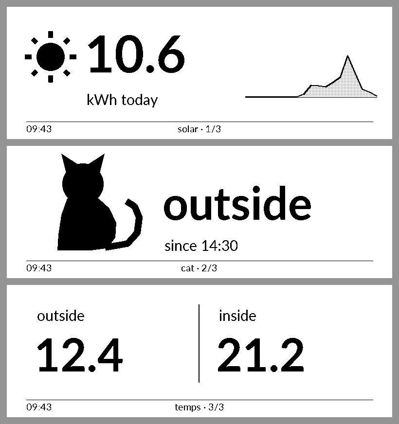
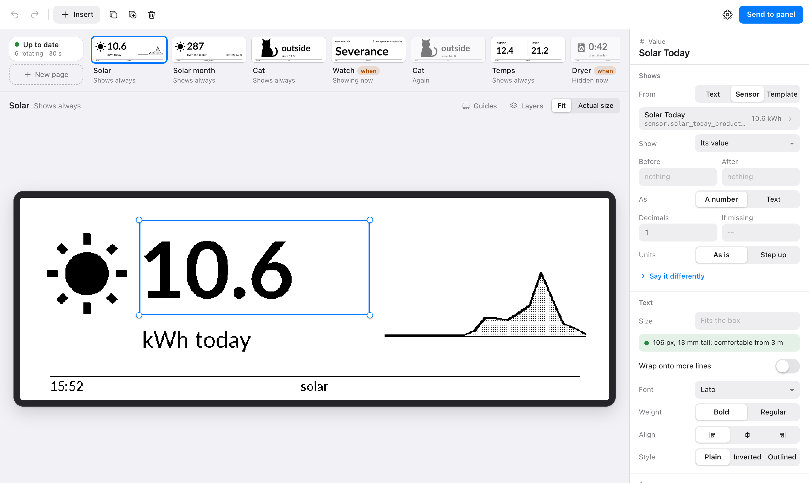
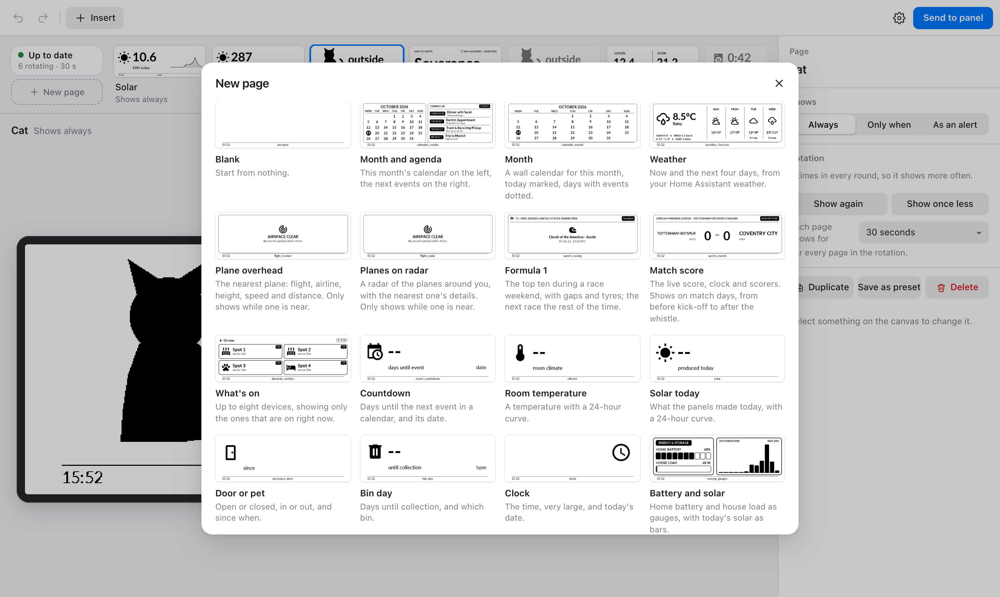
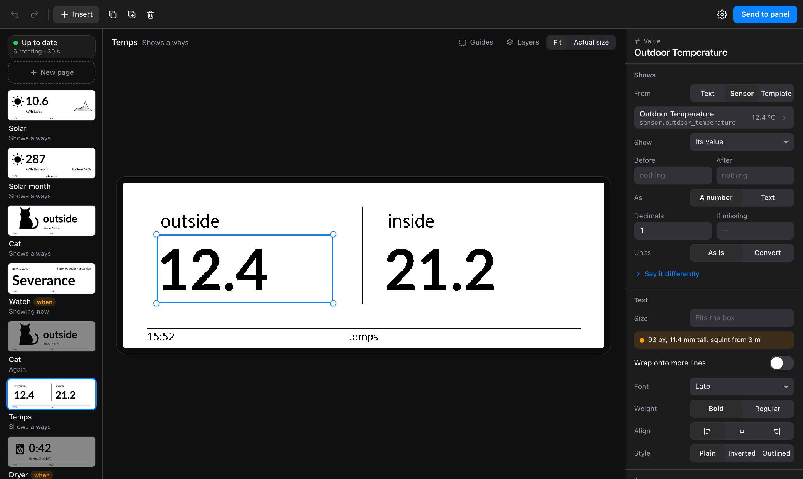
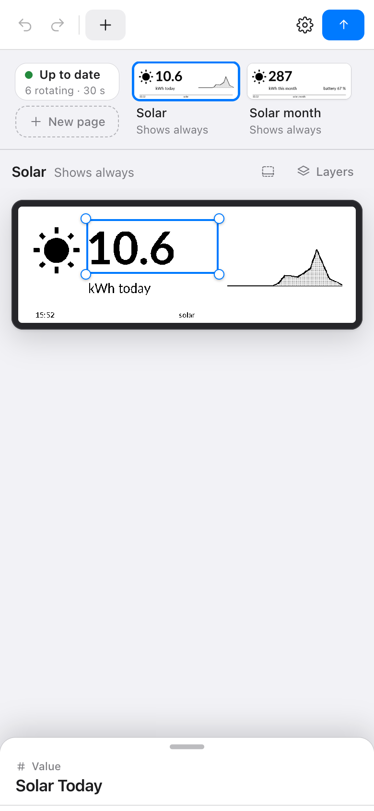

> Vibecoded! While I strive to keep things safe and limit vulnerabilities, you should be aware and use at your own risk.

# e-Paper Panel

A Home Assistant add-on for Elecrow's CrowPanel e-paper displays, and for
TRMNL screens if you turn them on. It turns
whatever you care about into calm, glanceable pages: on your desk under the
monitor, by the bed, on the wall, or across the room from the sofa. You design
the pages in a visual editor in Home Assistant's sidebar; the panel takes
turns showing them, and a page appears only when it has something to say.



## What it's good for

- **The game you're missing at work.** A live score with the clock and the
  scorers, for the Premier League, Champions League, La Liga, Bundesliga,
  Serie A, NBA, NFL, MLB or NHL: every match, your team, or a few of them
  ("Arsenal, Lakers"). The page turns up before kick-off and leaves after the
  final whistle on its own.
- **Race weekends.** Formula 1, Formula E, NASCAR and IndyCar: the top ten
  with gaps and tyres while a session runs, and the countdown to the next one
  the rest of the week.
- **What's flying over.** When a plane comes near, a page shows its flight,
  airline, route, height and speed, or a radar of everything around you.
  Around your home, an airport you type in, or places you save.
- **Your home's energy.** What the solar panels made today and this month,
  the battery, the house's load, as big numbers, gauges, curves and bar charts.
  Watts turn into kilowatts on their own.
- **The house at a glance.** Inside and outside temperatures, whether a door
  is open, where the cat is, which heaters are on right now.
- **Things that need you.** The dryer's time left, bin day, a countdown to
  something on the calendar. Pages like these show only while they matter,
  and an alert ("arriving home", "water leak") can take over the screen at
  once and hand it back later.
- **Your day.** This month's calendar, the next events, the weather and the
  next few days, a clock you can read from anywhere in the room.
- **Something to watch tonight.** What's new and unwatched in Jellyfin: one
  episode at a time with its name and when it arrived, or everything new on
  one screen.
- **Guests.** A QR code they point their phone at to join your Wi-Fi.
- **Anything else in Home Assistant.** Any entity: its value, one of its
  details, when it last changed, days until a date, in your own words.

The live data (sports, racing, planes, a weather fallback) needs no accounts
or keys. Data sources add things Home Assistant can't answer itself: any JSON
address, a long-term statistic, Jellyfin.

## Wherever you put it

E-paper doesn't glow, doesn't flicker and needs no power to hold a picture,
so it suits a desk as well as a wall. Tell the editor how far away you'll be
(desk, bedside, sofa or across the room) and it says, for every piece of
text, how tall it will be in millimetres and whether it reads from there.
Mount the panel landscape, portrait, or upside down so the cable runs the way
you need; the pages and the buttons follow.

## Made for every CrowPanel

The add-on is built for the whole CrowPanel e-paper family: the renderer, the
editor and the firmware generator all know every size below. Only the 5.79"
has been tested on a real device so far. If you have another one, please try
it and [open an issue](https://github.com/bek00letz/epaper-panel/issues)
saying what worked and what didn't, so the table can say "tested" for more of
them.

| Model | SKU | Pixels | Status |
|---|---|---|---|
| CrowPanel 5.79" | DIS08792E | 792 × 272 | Tested on the device |
| CrowPanel 4.2" | DIS08042E | 400 × 300 | Should work, not tested yet |
| CrowPanel 2.9" | DIS08029E | 296 × 128 | Should work, not tested yet |
| CrowPanel 7.5" | DIS08075E | 800 × 480 | Should work, not tested yet |
| CrowPanel 10.2" | DIS08102E | 960 × 640 | Should work, not tested yet |

## More than one screen

Add as many screens as you like, of any size, from the screen's name at the
top left of the editor (**Add a screen…**). Like setting up a phone, a new
screen can:

- **Set up as new**: start with one page that shows it's working (the date,
  the next sunrise or sunset, and a QR code to the guide). Make it yours from
  there.
- **Copy from another screen**: take that screen's pages, fitted to this one,
  and change them freely.
- **Show the same pages as another screen**: an edit shows on both. A screen
  of another size keeps its own layout: move something there and only that
  screen changes. Things it hasn't been told where to go are placed
  automatically, outlined in dashes until you move them.

Each screen has its own name, quiet hours, key and **Refresh** button, and
the switcher takes you between them. Change a screen's model and its pages
start from an automatic fit for the new size; switching back brings your old
layout back.

## TRMNL screens

A [TRMNL](https://usetrmnl.com) runs on a battery for months: it sleeps,
wakes on a timer or when you press its button, fetches one picture and sleeps
again. Its own firmware can use a server of your choosing, and this add-on can
be that server, so you design its pages in the same editor.

1. Turn on **TRMNL screens** in the add-on's **Configuration** tab and restart
   the add-on. While it's off, nothing of it exists.
2. In the editor, **Add a screen…**, pick **TRMNL**, name it and choose its
   pages. **Add and pair** listens for it for ten minutes.
3. On the TRMNL's Wi-Fi setup page, under **Advanced**, enter the address the
   editor shows as its **API server**, then connect. The editor says when it
   has paired.

What's different from a CrowPanel:

- **It shows one page per wake.** A timer wake moves on through the rotation
  (every item of every page, conditions and alerts included); its button goes
  to the next page. How often it wakes is a setting of that screen (every
  15 minutes to start).
- **Nothing can wake it early.** New pages and alerts show at its next wake,
  and the editor says so.
- **Quiet hours** show the sleep screen and let it sleep until they end. A
  press of its button shows a page for two minutes.
- **"updated 14:05"** in the footer is when that page last changed. While
  nothing changes the picture stays the same, so the TRMNL skips the download
  and doesn't flash. When it last checked in is **Last seen**, in the editor
  and in Home Assistant.
- **Its size is whatever it reports.** TRMNL's firmware runs on several
  screens; a size other than the TRMNL OG's 800 × 480 gets its own layout,
  placed automatically until you move things.
- **Battery and Wi-Fi** show in the editor and, with an MQTT broker, as
  sensors (the battery percentage is estimated from its voltage).

## Away from home

Take a screen to work and it keeps showing your pages. In **Settings ›
Reaching home**, choose how it gets them:

- **At home only** (the default): nothing changes.
- **Through Home Assistant's address**: wherever you already reach Home
  Assistant from outside (Home Assistant Cloud, Cloudflare, your own domain).
  The editor installs a small integration for this and asks for one restart.
- **Through your own address**: a tunnel or proxy of yours, such as
  Cloudflare Tunnel, pointed at the add-on. The editor shows what to point it at.

Away from home every screen needs its own key, and wrong keys slow down.
Install each CrowPanel again once (**Install or update**) so it uses the new
address over HTTPS, and add the other place's Wi-Fi there too. A TRMNL is
given the away address when you pair it.

Somewhere it knows no Wi-Fi, a CrowPanel opens its own ("Kitchen setup"), and
its screen tells you to join it from your phone and choose a network. The
password is in **Install or update**. A network chosen that way replaces the
ones in its file until you install it again, so list the places it goes
often. You can turn this off per screen.

## The editor



What you see on the canvas is drawn by the same engine that draws the panel,
so it can't disagree with it. Your pages run along the top in the order the
panel shows them; drag to reorder. Select anything to change it on the right;
select nothing and the right side shows the page: when it appears, how often,
what it's called.

- **New page** starts from a preset and asks which of your sensors it
  should show, or starts blank.
- **Insert** finds element types and your sensors in one search. Drag a
  sensor straight onto the canvas.
- **Copy, paste, and paste and match** move things between pages in the same
  place and size, or give one page the layout of another.
- **Together**: select two or more elements and give them one outline, one
  pill, or one inverted area. It follows them when they move and on every
  screen size. Dragging several at once snaps to the same guides as one.
- **Send to panel** puts your changes on the panel. Until then they're saved
  as drafts, and a dot shows something is waiting.
- **Now on the panel**, at the front of the page strip, says whether the
  panel is up to date, what's rotating, which pages are hidden right now and
  why, and lets you put it to sleep or clear ghosting.



It follows your system's light or dark mode, works with the keyboard (press
**?** for every shortcut), and works on a phone in the Home Assistant app.
The page strip can also sit below the canvas or down the side.

<p>


</p>

## Getting started

### 1. Install the add-on

1. In Home Assistant, go to **Settings › Add-ons › Add-on store**, open the
   **⋮** menu, choose **Repositories** and add
   `https://github.com/bek00letz/epaper-panel`.
2. Install **e-Paper Panel** and start it.
3. Open **e-Paper** in the sidebar.

Optional: with the **Mosquitto broker** add-on installed, the add-on's own
values (quiet hours, data sources, live scores and planes) also become Home
Assistant entities for your automations. Everything else works without it.

### 2. Set up the panel

1. In the editor, open **Settings** (the gear) › **Install or update**.
2. Check Home Assistant's address and your Wi-Fi details. Add any other
   networks it will meet (work, say). The add-on makes an encryption key and
   a frame token for you, and the password for the panel's own Wi-Fi, which
   it opens where it knows no network.
3. **Copy** or **Download** the panel's file. If Home Assistant's ESPHome
   folder is there, the add-on has already written it in.
4. In the **ESPHome** add-on: **New device**, give it a name, pick
   **ESP32-S3**, then **Skip**. **Edit** the new device, replace everything
   with the file, and **Install**. Use USB-C the first time; after that it
   updates over Wi-Fi.
5. When Home Assistant finds the panel under **Settings › Devices &
   services**, choose **Configure** and paste the encryption key.

When a release changes the panel's firmware, the changelog says so at the
top; install it again the same way. Until you do, the panel keeps working on
the firmware it has.

### 3. Your first page

1. Choose **New page** at the front of the page strip.
2. Pick a preset, say **Match score** or **Solar today**, and your sensor if
   it asks for one.
3. Choose **Add page**, then **Send to panel**.

## Doing more

### Pages that show only when it matters

Select the page, then click an empty part of the canvas. Under **Shows**,
choose **Only when** and pick a sensor and its state, like a timer that's
`active`. The sports, racing and flights widgets set this up for you with
one switch ("Only show on match days"). **As an alert** takes over the panel
the moment the condition turns true and hands it back after the minutes you
set. Now on the panel lists every hidden page and why it's hidden.

A page that appears or disappears reaches the panel at its next check, so a
panel that checks rarely (on a battery, say) isn't woken for it. Alerts, quiet
hours and **Send to panel** reach it at once.

### The rotation

The page strip is the rotation. Drag a page to move it, **Show again** puts
a page in twice so it comes round more often, and **Take out** keeps a page
without showing it. **Each page shows for** sets how long every page stays
up.

### The same layout on two pages

Select everything on one page (⌘A), copy (⌘C), open the other page, and
**Paste and match** (⌥⇧⌘V). The elements already there take the place, size
and text style of what you copied; your sensors and words stay.

### Watts that become kilowatts

Select a value, and under **Units** choose **Step up**: 950 W stays watts,
1,234 W shows as 1.23 kW. It works for Wh, g, m, bytes, seconds and more.
**Convert** shows a value in another unit, like m/s in km/h or °C in °F.
**Add a label that follows the unit** puts "W used" underneath that becomes
"kW used" by itself.

### Quiet nights

**Settings › Quiet hours** sets a nightly window for the screen you're
editing, and optionally "while nobody's home". Each screen has its own. The panel stops flashing and downloading, and shows a sleep
screen that says when it wakes. Its buttons still work. Sleep it any time by
holding the dial's centre, from Now on the panel, or with its **Sleep**
switch in Home Assistant.

### Your own data

**Settings › Data sources** turns something outside Home Assistant into a
sensor your pages can show: what's new and unwatched in Jellyfin (grouped by
series, only the recent ones), any JSON address, or a long-term statistic
like this month's solar. **Test** shows what it would publish. Sources are
fetched in the background, so a slow or sleeping server never holds up the
panel.

Jellyfin's details come separately, so a page can show just the part it
wants: the episode's name, which episode (S02E04), how many are new, when it
arrived, a film's year and length, and the next few titles. **New page** has
three Jellyfin presets: **New to watch**, **Episode card** and **Up next**.

### When something stops answering

Every outside service (the sports and racing feeds, Flightradar24, OpenSky,
each data source) is watched. One that has failed for five minutes turns on a
problem sensor in Home Assistant, `binary_sensor.epaper_problem_<name>`, with
the error and when it last worked, so you can build an automation on it.
Meanwhile its entities stay in Home Assistant instead of disappearing.

### Small things worth knowing

- Click again on the same spot to reach what's underneath; **Layers** shows
  the order.
- Long text can **wrap onto more lines**.
- Widgets have a **Text size** slider, and **Break apart** turns weather,
  flights, agenda, racing and match widgets into pieces you can move.
- Nothing asks "are you sure?": everything has **Undo**.
- The previous editor is still there for now: add `?classic=1` to the
  editor's address.

## On the panel

The panel shows your pages as **categories**; some have several **items**
inside (several planes, several games, several episodes). The footer shows the
time, where you are, and a padlock when something is locked.

| Control | Press | Hold |
|---|---|---|
| Dial, turn | Next or previous category, or item | |
| Dial, centre | Switch between categories and the items inside one | 1 s: sleep, or wake |
| Top button | Lock the category | Lock this page |
| Bottom button | Back to the first page | Fetch new pages now and clear ghosting, in one flash |

While you're pressing buttons, new pages wait until you've stopped for 15 s,
so nothing changes under your finger. E-paper keeps faint traces of earlier
pictures; the panel cleans them with one full flash, but only when nobody's
looking, and you can set how often in **Settings › Screen**.

## Home Assistant

### Actions

For automations, dashboard buttons and scroll remotes like the IKEA BILRESA,
the panel offers these as `esphome.<device>_<action>`:

| Action | Takes | Does |
|---|---|---|
| `refresh_now` | | Fetch new pages now (or once someone stops scrolling) |
| `show_page` | `index` | Go to a page, counting from 0 in rotation order |
| `show_category` | `category`, `sub` | Go to a category and an item in it |
| `page_step` | `delta` | Step forward or back: categories or items, whichever is active |
| `category_step`, `sub_step` | `delta` | Step categories, or items, specifically |
| `mode_toggle` | | Switch between categories and items |
| `lock_toggle` | | Lock or unlock, whichever is active |
| `category_pin_toggle`, `hold_toggle` | | Lock the category, or this page |

### Entities

From the panel: **Sleep**, **Refresh interval**, **Ghost clear after**,
**Ghost clearing**, **Clear ghosting**, **Panel IP** and **Panel Wi-Fi**.

From the add-on, with an MQTT broker, under an **E-Paper Studio** device:
`sensor.epaper_quiet_hours`, `sensor.epaper_panel_last_render`, one sensor per
data source, the live widgets' own (`sensor.epaper_flights_overhead`,
`sensor.epaper_closest_aircraft`, `sensor.epaper_racing_<series>`,
`sensor.epaper_sports_<league>`), `sensor.epaper_panel_pages` (how many pages
the panel holds right now, and what was left out), a problem sensor per
outside service, and a **Refresh panel** button. A second screen gets its own
quiet hours, last render, pages and Refresh entities, named after it
(`sensor.epaper_quiet_hours_kitchen`); the first keeps the names above. A
TRMNL also gets `sensor.epaper_battery_<name>` (estimated percent),
`sensor.epaper_battery_voltage_<name>`, `sensor.epaper_wifi_signal_<name>` and
`sensor.epaper_last_seen_<name>`, and no Refresh button, since it can't be
woken. All of them show as unavailable while the add-on is stopped. An entity stays while its source is down; it's
removed only once nothing produces it any more.

## Privacy and security

- **The editor is behind your Home Assistant login** and answers only Home
  Assistant's own proxy.
- **The panel's port (8099) serves pictures of pages and nothing else**: no
  layouts, entity names or places. Every screen has its own key, made for
  you; a TRMNL is given its key only in the ten minutes after you ask to pair
  it. At home only (the default), the port refuses anything that came through
  a tunnel. Away from home, nothing gets in without a key, and a sender that
  keeps getting keys wrong is refused for a while.
- **No accounts, no analytics.** The add-on reaches outside services only for
  the widgets you put on a page and the data sources you set up. Airport codes
  are looked up from a copy bundled with the add-on.
- **The panel talks to Home Assistant encrypted**, with its own key, which
  also protects its updates over Wi-Fi.

## How it works

Home Assistant does the work; the panel only draws. The add-on renders every
page with real fonts, turns it into black and white, and packs all the pages
into one checked file. The panel downloads it in the background and copies one
page at a time into the display, so a button press redraws in under a second
with no network round trip. [ARCHITECTURE.md](ARCHITECTURE.md) has the
measurements behind each decision.

## Honest limitations

- **Only the 5.79" is tested on a device** (see above), and only as the one
  screen: two CrowPanels side by side, and HTTPS through Cloudflare or Home
  Assistant Cloud, haven't been tried on real hardware yet.
- **Away from home, a CrowPanel can't be woken early.** Alerts and the
  Refresh button reach it through Home Assistant's own connection to it,
  which only exists at home. Away, it picks up changes on its own timer.
- **A network chosen on a CrowPanel's own Wi-Fi replaces the ones in its
  file** until you install it again (ESPHome remembers only one). List the
  places it goes often in **Install or update** instead.
- **A TRMNL doesn't check HTTPS certificates.** Its firmware encrypts the
  connection but doesn't check who it's talking to, so on a network you don't
  trust, something pretending to be your server could read its key. That key
  only fetches that screen's pictures, and pairing it again replaces it. A
  CrowPanel does check, against the usual public certificate authorities.
- **TRMNL support is built from its open-source firmware, not tried on one
  yet.** Pairing end to end, which pictures its decoder takes in practice,
  HTTPS through Cloudflare or Home Assistant Cloud, and real battery life are
  still to be checked on a device. While pairing it briefly shows its own
  "visit trmnl.com/start" screen; that text is in its firmware. For screens
  other than the TRMNL OG, the physical size behind the legibility note is an
  estimate.
- **You choose the entities.** Presets and search help, but it doesn't guess
  what belongs on your screen.
- **Up to about 77 pages at a time** on the 5.79" (the panel keeps 2 MB of them).
  If the rotation needs more, every page keeps its first item and the extra
  items are shared out; what was left out shows in
  `sensor.epaper_panel_pages`.
- **No battery reading on a CrowPanel.** The stock 5.79" can't read its
  battery; it would need a resistor divider soldered on. (A TRMNL reports its
  own.)
- **Low Power Mode hasn't been tried on a real panel yet.** It's built from
  end to end, but how long a battery lasts, whether the buttons wake it
  reliably, and whether the screen flashes on every check are still to be
  measured. A panel installed before Low Power Mode existed stays connected
  until you install it again; the editor says so.

## Development

```bash
# run it on your computer, with stand-in data when there's no Home Assistant
DATA_DIR=/tmp/epaper-data ./.venv/bin/python addon/app/server.py

# the tests, including the panel's firmware core compiled on this machine
./.venv/bin/python -m unittest discover -s tests
```

The editor is then at `http://127.0.0.1:8080/`, and what the panel would
fetch at `http://127.0.0.1:8099/frames.png`. Read [AGENTS.md](AGENTS.md)
before changing anything, and the [changelog](addon/CHANGELOG.md) for what
changed in each release.

## Credits

[ESPBoards](https://github.com/ESPBoards/esphome-lvgl-crowpanel-epaper-5.79-4.2)
for the 5.79" and 4.2" display component; Elecrow for publishing their demo
source, the reference for the pins;
[Lato](https://www.latofonts.com/) (SIL OFL),
[DejaVu](https://dejavu-fonts.github.io/) (free licence),
[Roboto Mono](https://fonts.google.com/specimen/Roboto+Mono) (Apache 2.0);
[Material Design Icons](https://pictogrammers.com/library/mdi/) (Apache 2.0);
[OurAirports](https://ourairports.com/) (public domain) for airport codes.
